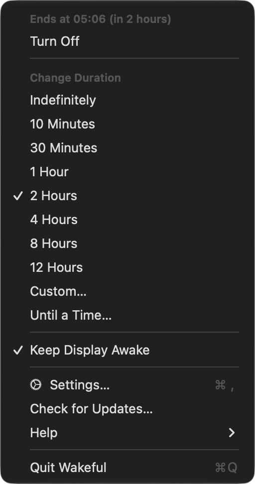
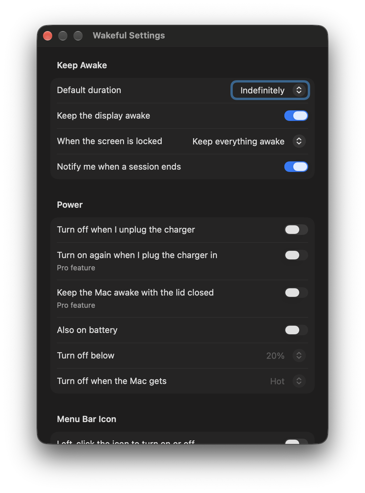

<p align="center">
  
</p>

<h1 align="center">Wakeful</h1>

<p align="center">Keep your Mac awake from the menu bar.</p>

<p align="center">
  <a href="https://github.com/duongdev/wakeful/releases/latest"></a>
  <a href="https://github.com/duongdev/wakeful/actions/workflows/ci.yml"></a>
  
  <a href="LICENSE"></a>
</p>

<p align="center">
  
  &nbsp;&nbsp;
  
</p>

## Features

- Turn on for a set time (10 minutes to 12 hours), a custom length, until a time of day, or until you turn it off.
- Choose whether the display may sleep while the Mac stays awake.
- When the screen is locked, let the display sleep or let the Mac sleep, if you want.
- Stop when you unplug the charger, if you want.
- Wakeful Pro: keep the Mac awake with the lid closed and no external display, and turn on again when you plug the charger back in.
- Start at login, start a session at launch, and get a notice when a session ends.
- Left-click the icon to turn on or off, if you want. Right-click then opens the menu.
- A global keyboard shortcut to turn on or off.
- Shortcuts actions, a `wakeful` command-line tool, and a `wakeful://` URL scheme for automation.
- Show the time left next to the menu bar icon, if you want. Color the icon or add a dot while on, if you want.
- Automatic updates, which you can turn off.
- In English, Vietnamese, Spanish, French, German, Italian, Portuguese (Brazil), Russian, Japanese, Korean, and Chinese (Simplified and Traditional). Wakeful follows your Mac's language; to choose another, use Settings › General › Language.
- No tracking. No network access except update checks.

## Requirements

macOS 14 or later, Apple silicon or Intel.

## Install

Download `Wakeful-<version>.dmg` from the [latest release](https://github.com/duongdev/wakeful/releases/latest), open it, and drag Wakeful to Applications. Builds are signed and notarized by Apple.

A Homebrew cask is coming.

## Shortcuts

Wakeful adds these actions to the Shortcuts app:

| Action | Does |
| --- | --- |
| Turn On Wakeful | Turns on, with an optional duration or end time, and an optional display choice for that session. |
| Turn Off Wakeful | Turns off. |
| Toggle Wakeful | Turns on or off, with an optional duration and display choice. Returns the new state. |
| Is Wakeful On | Returns true or false. |
| Get Wakeful Time Left | Returns the time left. Returns nothing when off or on with no end time. |
| Change Wakeful Time | Adds time, or removes it with a negative value. |

With Siri, say "Turn on Wakeful", "Turn off Wakeful" or "Toggle Wakeful".

## Command line

The `wakeful` tool is inside the app. To use it from Terminal, link it into your `PATH`:

```bash
sudo mkdir -p /usr/local/bin
```

```bash
sudo ln -sf /Applications/Wakeful.app/Contents/Helpers/wakeful /usr/local/bin/wakeful
```

```bash
wakeful on              # your default duration
wakeful on 45m          # also 2h, 1.5h, 1h30m, 90s, or a number of minutes
wakeful on until 18:00  # a past time means tomorrow
wakeful on forever
wakeful toggle
wakeful off
wakeful status          # for example: On, 1h 15m left (until 18:00)
```

The tool starts Wakeful if it is not running.

## URL scheme

```bash
open -g 'wakeful://activate?hours=1.5'
open -g 'wakeful://activate?minutes=30'
open -g 'wakeful://activate?until=18:00'
open -g 'wakeful://activate?indefinitely'
open -g 'wakeful://toggle'
open -g 'wakeful://deactivate'
open 'wakeful://settings'
```

With no duration, `activate` and `toggle` use your default duration. `until` takes a 24-hour time; a past time means tomorrow.

## Build from source

See [CONTRIBUTING.md](CONTRIBUTING.md).

## License

[MIT](LICENSE)
